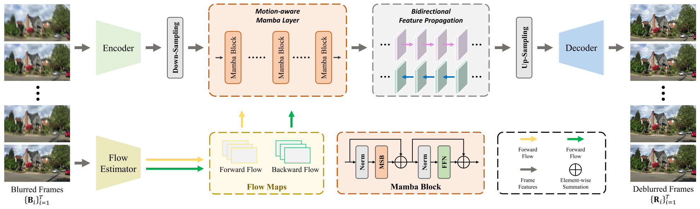

## 📖 MVSSM: Motion-aware Visual State Space Model for Efficient Video Deblurring

#### [Paper](https://openaccess.thecvf.com/content/CVPR2026F/html/Zhou_MVSSM_Motion-aware_Visual_State_Space_Model_for_Efficient_Video_Deblurring_CVPRF_2026_paper.html)

> [Chen Zhou](https://github.com/Frank-Zhou-01), [Tao Wu](https://jsjxy.cuit.edu.cn/info/1063/1799.htm), [Wei Liu](https://sais.sjtu.edu.cn/faculty/587.html), [Xi Wu](https://jsjxy.cuit.edu.cn/info/1063/1812.htm), and [Ying Fu](https://jsjxy.cuit.edu.cn/info/1063/1803.htm)<br>
> Chengdu University of Information Technology, Shanghai Jiao Tong University

<hr />

> **Abstract**: *Video deblurring remains a challenging task due to the complex and spatially varying motion blur present in real-world scenes.  Recent state space models (SSMs) have shown great promise in modeling long-range dependencies with linear complexity;  however, their fixed scanning strategies often fail to capture motion-aware contextual information effectively. To address this limitation, we propose MVSSM, a Motion-aware Visual State Space Model that dynamically adapts its feature scanning direction based on estimated motion trajectories. Specifically, our Motion-aware Scanning Block (MSB) leverages optical flow to determine the dominant motion direction and selects an optimal scanning path—horizontal, vertical, or diagonal—to align feature propagation with actual motion patterns. Furthermore, we introduce a Multi-scale Dynamic Feature Fusion (MDFF) module that enhances spatiotemporal representation through pixel-wise dynamic convolutions across multiple scales. Experimental results on multiple synthetic and real-world datasets demonstrate that the proposed method not only substantially reduces computational burden but also achieves state-of-the-art performance in video deblurring.*
<hr />

This repository is the official PyTorch implementation of our CVPR2026 findings paper "[MVSSM: Motion-aware Visual State Space Model for Efficient Video Deblurring](https://openaccess.thecvf.com/content/CVPR2026F/html/Zhou_MVSSM_Motion-aware_Visual_State_Space_Model_for_Efficient_Video_Deblurring_CVPRF_2026_paper.html)".

### Network


## Quick Started
### 1. Environment Set Up
> - Python 3.9, PyTorch == 2.0.1
> - BasicSR 1.4.2
> - mamba_ssm == 1.1.0, causal-conv1d == 1.1.0
> - Platforms: Ubuntu 18.04, cuda-11.8

```bash
git clone https://github.com/Frank-Zhou-01/MVSSM.git
cd MVSSM
conda create -n MVSSM python=3.9
conda activate dstnetplus
# Install dependent packages
pip install -r requirements.txt
# Install cupy
# Please make sure that the installed Cupy version matches your existing CUDA installation!
pip install cupy-cuda11x
# Install BasicSR
python setup.py develop
```

### 2. Download datasets 
Used training and testing sets can be downloaded as follows:

| Training Set                                                          |                          Pretrained model                          |                            Visual Result                            |
|:----------------------------------------------------------------------|:------------------------------------------------------------------:|:-------------------------------------------------------------------:|
| [GOPRO](https://seungjunnah.github.io/Datasets/gopro)                 | [Hugging Face](https://huggingface.co/FrankZhou01/MVSSM/tree/main) | [Hugging Face](https://huggingface.co/FrankZhou01/MVSSM/tree/main)  |
| [DVD](https://www.cs.ubc.ca/labs/imager/tr/2017/DeepVideoDeblurring/) | [Hugging Face](https://huggingface.co/FrankZhou01/MVSSM/tree/main) | [Hugging Face](https://huggingface.co/FrankZhou01/MVSSM/tree/main)  |
| [BSD](https://github.com/zzh-tech/ESTRNN)                             | [Hugging Face](https://huggingface.co/FrankZhou01/MVSSM/tree/main) | [Hugging Face](https://huggingface.co/FrankZhou01/MVSSM/tree/main)  |

### 3. Run the training code
```
# train MVSSM on GOPRO dataset
python -m torch.distributed.run --nproc_per_node=8 --master_port=4321 python basicsr/train.py -opt options/train/train_GOPRO.yml --launcher pytorch

# train MVSSM on DVD dataset
python -m torch.distributed.run --nproc_per_node=8 --master_port=4321 python basicsr/train.py -opt options/train/train_DVD.yml --launcher pytorch

# train MVSSM on BSD dataset
python -m torch.distributed.run --nproc_per_node=8 --master_port=4321 python basicsr/train.py -opt options/train/train_BSD.yml --launcher pytorch
```

### 4. Quick inference
- Download the pretrained models. 

Please download the pretrained and put it in `./expriments/`.

- Download the testing dataset. 

- Run the following commands:
```
python basicsr/test.py -opt options/test/test_GOPRO.yml
cd results
python get_mean_frame.py
python merge_full.py
python calculate_psnr.py
```
- The test results will be in './results'.

## Citation 

If you find our work helpful for your research, please consider giving a star ⭐ and citation 📝 
```bibtex
@InProceedings{Zhou_2026_CVPR,
    author    = {Zhou, Chen and Wu, Tao and Liu, Wei and Wu, Xi and Fu, Ying},
    title     = {MVSSM: Motion-aware Visual State Space Model for Efficient Video Deblurring},
    booktitle = {Proceedings of the IEEE/CVF Conference on Computer Vision and Pattern Recognition (CVPR) Findings},
    month     = {June},
    year      = {2026},
    pages     = {4855-4865}
}
```

## License

This project is open sourced under MIT license. 

## Acknowledgement
This project is based on [BasicSR](https://github.com/XPixelGroup/BasicSR), [DSTNet](https://github.com/xuboming8/DSTNet), and [EAMamba](https://github.com/daidaijr/EAMamba). 